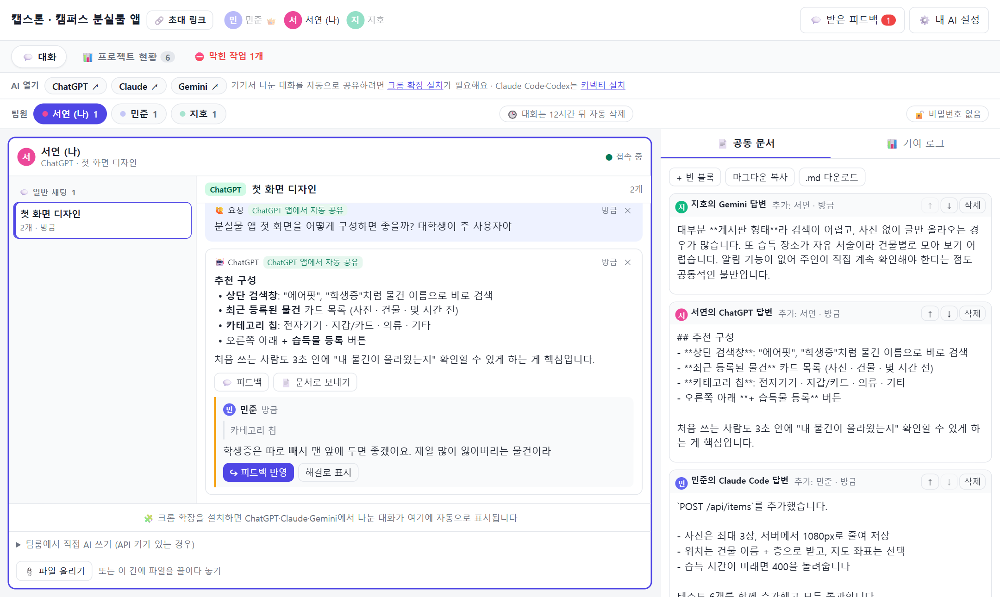
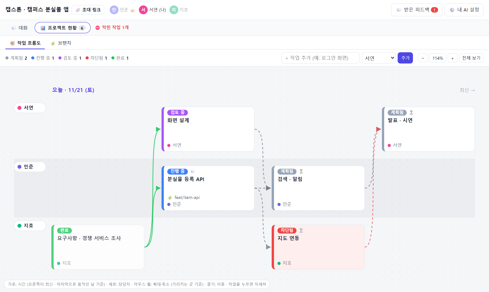
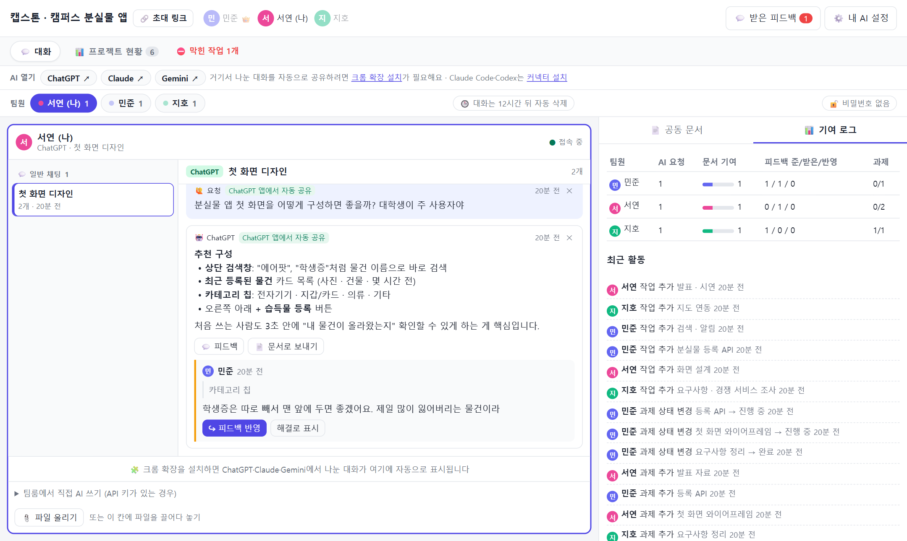

# 🤝 AI 팀룸

**팀원 각자가 자기 AI와 일하는 과정을, 한 화면에서 실시간으로 함께 보는 팀 프로젝트 협업 도구**

ChatGPT · Claude · Gemini · Claude Code · Codex 등 각자 평소에 쓰던 AI를 그대로 쓰면, 그 대화가 팀룸에 자동으로 올라옵니다. 팀원은 답변 문장을 집어서 바로 피드백을 남기고, 좋은 답변은 공동 문서로 모으고, 프로젝트 진행 상황은 작업 흐름도와 브랜치 그래프로 확인합니다.

> 대학 팀 프로젝트에서 "누가 AI로 뭘 했는지 모르겠다", "결과만 붙여 넣고 과정이 안 보인다"는 문제를 풀기 위해 만들었습니다. 실제 팀에서 쓰면서 계속 고치고 있습니다.

**⬇️ [최신 버전 다운로드 (Releases)](https://github.com/seongwon0411/ai-teamroom/releases/latest)** — Windows 데스크톱 앱 `AI-Teamroom-v2.exe` · 크롬 확장 zip


<sub>팀원의 AI 답변이 자동으로 올라오고, 문장을 집어 피드백을 남기면 받은 사람이 ↪ 피드백 반영으로 자기 AI에 바로 넣습니다. 오른쪽은 출처가 남는 공동 문서.</sub>


<sub>프로젝트 현황 › 작업 흐름도. 가로축은 시간(오른쪽이 최신), 세로는 담당자. 선후관계와 막힌 작업이 한눈에 보입니다.</sub>


<sub>기여 로그. 팀원별 AI 요청 · 문서 기여 · 피드백 · 과제가 자동으로 집계되고, 최근 활동이 시간순으로 쌓입니다.</sub>

<sub>※ 스크린샷은 가짜 팀원과 가짜 대화로 만든 데모 방입니다.</sub>

---

## 이런 문제를 풉니다

| 기존 팀플 | AI 팀룸 |
|---|---|
| 각자 AI랑 따로 대화하고 결과만 카톡에 붙여 넣음 | 대화가 **글자 단위로 실시간** 팀원 화면에 보임 |
| "그 답변 이상한데?"를 말로 설명해야 함 | 답변 **문장을 드래그 → 💬 피드백**, 받은 쪽은 **↪ 반영** 한 번에 AI 입력창으로 |
| 기여도를 나중에 기억에 의존해 정리 | AI 요청 · 문서 기여 · 피드백을 **자동 집계** |
| 진행 상황이 각자 머릿속에만 있음 | **작업 흐름도**(시간축) + **Git 브랜치 그래프**로 한눈에 |

## 주요 기능

- **실시간 AI 작업 공유** — 팀원별 칼럼에 대화가 생성되는 그대로 흘러나옵니다. 대화별로 접고 펼치기, AI 종류별 필터.
- **문장 단위 피드백 → AI 반영** — 인용과 함께 피드백을 보내면, 받은 사람이 버튼 한 번으로 자기 AI에게 반영 요청을 넣습니다.
- **공동 문서** — 답변을 📄 문서로 보내면 출처(누구의 어떤 AI)가 남고, 편집 · 순서 변경 · Markdown 내보내기를 지원합니다.
- **프로젝트 현황** — 작업 5단계(계획 · 진행 · 검토 · 차단 · 완료)와 선후관계를 그린 흐름도, GitHub 원격/로컬 브랜치 그래프.
- **과제 보드 · 기여 로그** — 할 일과 담당자, 활동 타임라인.
- **방 비밀번호 · 보관 기간 설정** — 초대 링크만으로 들어올 수 없게 잠글 수 있습니다.

## 개인 대화는 보호합니다

- **공유 토글이 켜져 있고, AI가 실제로 답을 생성한 대화만** 올라갑니다. 예전 대화를 열어 보기만 하면 공유되지 않습니다.
- Claude Code · Codex는 **팀 프로젝트로 지정한 폴더**에서 나눈 대화만, 질문과 답변만(도구 실행 내용 · 생각 과정 제외) 올립니다.
- 글 속 `C:\Users\…\파일` 같은 로컬 경로는 파일 이름만 남깁니다.
- API 키는 저장하지 않습니다(팀 공용 키는 서버 메모리에만 보관).

## 어떻게 AI 대화를 가져오나

API 키 없이 **각자 이미 쓰는 구독 그대로** 동작하도록, AI마다 다른 방법을 씁니다.

```
 ┌────────────────┐   ┌──────────────────┐   ┌───────────────────────┐
 │ 크롬 확장       │   │ 데스크톱 앱(exe)  │   │ 커넥터 (Node)          │
 │ ChatGPT·Claude  │   │ AI 사이트를 앱    │   │ ~/.claude/projects     │
 │ ·Gemini 웹 화면 │   │ 안에서 열고 읽음  │   │ ~/.codex/sessions      │
 │ 을 읽음         │   │ + 팀룸 창         │   │ 기록 파일을 지켜봄      │
 └───────┬────────┘   └────────┬─────────┘   └──────────┬────────────┘
         └───────────────┬─────┴────────────────────────┘
                         ▼
               ┌────────────────────┐        ┌──────────────┐
               │ 팀룸 서버 (Node)    │──SSE──▶│ 팀원 브라우저 │
               │ 방 상태 · 파일 저장 │        │ / 팀룸 창     │
               └────────────────────┘        └──────────────┘
```

- **크롬 확장** (`extension/`) — 로그인된 AI 웹페이지의 대화를 읽어 전송. 오프라인이면 대기열에 보관 후 재전송. 사이드패널에 팀룸 표시.
- **데스크톱 앱** (`v2/desktop/`, Electron) — 설치 없는 단일 exe. AI 사이트를 앱 안에서 열고, 옆에 팀룸 창을 띄웁니다.
- **커넥터** (`v2/connector/`) — Claude Code · Codex가 남기는 대화 기록 파일을 감시해서 공유. Claude/Codex 설정은 건드리지 않습니다. Claude 데스크톱 앱 채팅은 Windows UI Automation으로 읽습니다.
- **서버** (`v2/server.js`) — 순수 Node `http` 서버. SSE 실시간 전송(막힌 환경에서는 자동으로 폴링 전환), 방별 JSON 저장.
- **클라우드 배포** (`v2/cloud/`) — 오라클 클라우드 무료 VM에 한 번에 올리고 업데이트 · 백업하는 스크립트. HTTPS 자동, 매일 백업.

## 기술 스택

Node.js (빌드 도구 없는 순수 JS) · Server-Sent Events · Electron · Chrome Extension MV3 · Windows UI Automation · Oracle Cloud Free Tier

## 직접 실행해 보기

```bash
cd v2
npm install @anthropic-ai/sdk
node server.js          # → http://localhost:3100
```

방을 만들고 **🔗 초대 링크**를 다른 브라우저에서 열면 팀원 화면을 확인할 수 있습니다. AI 키가 없으면 데모 응답으로 동작합니다.

- 데스크톱 앱: `cd v2/desktop && npm install && npm start` (빌드: `npm run dist`)
- 커넥터: `node v2/connector/teamroom-connector.mjs setup`
- 클라우드 배포 안내: [v2/cloud/클라우드-올리기.md](v2/cloud/클라우드-올리기.md)

## 폴더 구성

| 경로 | 내용 |
|---|---|
| `v2/` | **현재 버전** — 서버, 웹 화면, 데스크톱 앱, 커넥터, 클라우드 배포 |
| `extension/` | 크롬 확장 |

## 테스트

- 데스크톱 앱 자가 테스트: `TEAMROOM_TEST=1`로 실행

## 한계와 다음 단계

- AI 사이트 화면 구조가 바뀌면 읽는 부분을 고쳐야 합니다.
- 공동 문서는 블록 단위 저장이라, 구글 독스식 동시 편집(Yjs 등)은 아직 아닙니다.
- Windows 위주로 만들고 검증했습니다.
